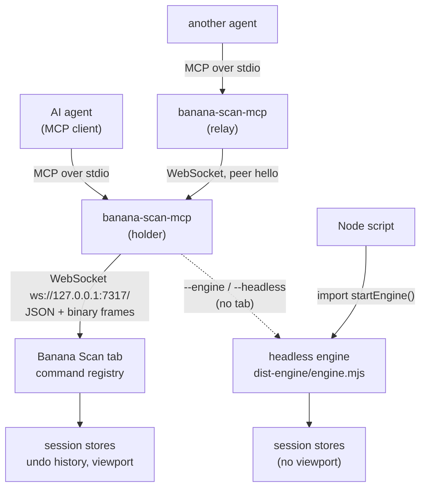

<!-- SPDX-License-Identifier: AGPL-3.0-only -->
# Banana Scan API

Everything Banana Scan can be asked to do from outside the mouse is a
**command**: one verb of the session — `scan.open`, `element.fit`,
`reverse.feature.add` — with a JSON Schema for its input, run as one step of
the undo history, answering JSON. The panels call the same code paths. There
is one set of commands, reached three ways:

| Way in | Who uses it | Where |
|---|---|---|
| **MCP tools** | an AI agent (Claude Code, Codex, Claude Desktop, Cursor, LM Studio …) | `banana-scan-mcp`, the server in [`mcp/`](../../mcp/), over stdio |
| **The page link** | the MCP server, or a client of your own | a WebSocket on `127.0.0.1` the Banana Scan tab connects to |
| **The headless engine** | a Node process, with no browser | `dist-engine/engine.mjs`, built by `npm run build:engine` |

This page is the contract: how a command is named, called, queued and
answered, and what each transport adds. **The commands themselves — every
one, with every field — are in the [command reference](commands/README.md)**,
written from the registry.



Contents:
[Commands](#commands) ·
[Errors](#errors) ·
[The MCP server](#the-mcp-server) ·
[The page link](#the-page-link) ·
[The headless engine](#the-headless-engine) ·
[Address parameters](#address-parameters) ·
[Adding commands](#adding-commands-plugins) ·
[Keeping this current](#keeping-this-reference-current)

---

## Commands

### Names

A command's name is a namespace and a verb, dotted, lower case:
`^[a-z][a-z0-9_]*(\.[a-z][a-z0-9_]*)+$` — `element.fit`,
`reverse.body.fillet_read`. The app registers its own namespaces (`scan`,
`element`, `dimension`, `section`, `flat`, `deviation`, `thickness`, `align`,
`view`, `export`, `project`, `history`, `session`, `report`, `guide`,
`workspace`); a plugin registers its under its id or its workspace's
(`reverse.*` from [`plugins/reverse`](../../plugins/reverse/), `mesh.*` from
[`plugins/mesh-tools`](../../plugins/mesh-tools/)). A build offers the app's
commands plus whatever its plugins add, so the list a page reports is the
authority: `{ method: "list" }` on the link, `tools/list` over MCP,
`listCommands()` headless.

Each command, as a caller sees it (`CommandInfo`, `src/commands/types.ts`):

| Field | |
|---|---|
| `name` | as above |
| `title` | a few words, as a menu says it |
| `description` | what it does, needs and returns — the text an agent reads |
| `input` | a JSON Schema object (see [Input](#input)) |
| `readOnly` | changes nothing: runs at once, beside anything else, no undo step |
| `returnsFile` | the result carries `file: { name, mimeType, bytes }` |
| `returnsImage` | the file is a picture (PNG) to look at rather than keep |
| `exact` | only when true: the answer's numbers are fed back as inputs (a plane's frame) — keep every digit |
| `long` | only when true: a read that may take long; the MCP server runs it as a job |
| `names` | only when set: `{ space, at }` — the input paths that name new things, unique within `space` |
| `askForLess` | only when set: what to ask for when an answer was too long to carry |

### Input

The input is always an object, checked against the command's schema before
anything runs; a mismatch is refused `invalid_input` with the path and what
was wrong. The schema language is a small JSON Schema subset
(`src/commands/schema.ts`): `object` (with `properties`, `required`,
`additionalProperties: false`), `array` (`items`, `minItems`, `maxItems`),
`string` (`enum`, `minLength`), `number` and `integer` (`minimum`,
`maximum`, `exclusiveMinimum`), `boolean`, `null`, and `oneOf`. Two
additions:

- `format: "binary"` on a string marks a file's bytes. The page takes a
  `Uint8Array`; the link sends it as a binary frame; the MCP server takes a
  `path` in its place and streams the file.
- `names` on an object lists number fields that may instead be given by a
  parameter's name or an expression in another field, so a string given for
  the number is refused with the way to write it.

Conventions every command keeps:

- **Lengths are millimetres, angles degrees.**
- **A place on the scan** is `{ "point": [x, y, z] }` — the nearest scan
  vertex is taken — or `{ "vertex": n }`. To fit a feature, aim at its
  middle, not an edge.
- **An element or dimension** is named by its id (an integer) or its name
  (`"Sphere 1"`).
- **`detail`** on many commands: `brief` (the default) answers what changed;
  `full` answers every element where it now is.
- **On the 2D sheet** (`flat.*`) places are `[x, y]` in the sheet's own
  millimetres, origin at the image's bottom-left, y up; an edge is named by
  its chain number.

### How a command runs

`runCommand(name, input, onProgress?, job?, deferred?)` in
`src/commands/registry.ts`:

1. **Unknown name** → `unknown_command`. **Input off the schema** →
   `invalid_input`.
2. **A read** (`readOnly`) runs at once, beside whatever else is running —
   `session.state` answers while a build runs. One that turns or pictures the
   viewport runs one at a time with every other such command, so two
   pictures asked for at once never share the camera.
3. **A change** waits for the change before it, is refused `busy` while the
   session is loading, fitting or measuring something of its own, and runs as
   **one step of the undo history** under its label. `history.undo` takes it
   back; so can the person, in the tab.
4. **Progress**: while it runs, the status line's text is passed to
   `onProgress` (on the link, `{ event: "progress", id, text }`).
5. **Time limit**: 10 minutes unless a command says otherwise. Past it the
   caller is answered `timeout` and the queue moves on; a command that looks
   at its abort signal stops changing the session.
6. **Deferred**: a change marked deferred may leave work only the last of
   several changes needs — a model's rebuild — for later; it is finished
   before the next command that is not deferred.
7. **Interrupts and discards**: a stop command (`reverse.build.stop`) runs at
   once, over the busy guard; a change that throws the session's work away
   (`scan.open` / `project.load` with `discard`) stops a plugin's work first
   rather than wait for it.
8. **Jobs**: a run given a `job` name is kept among the recent outcomes —
   `session.recent` gives the last 100, so a caller that lost an answer can
   still read what became of it.

### Answers

A result is the session as the stores hold it afterwards, as JSON. The page
answers full-precision numbers; the MCP server shortens every number that is
not whole to six significant digits (four decimals past a hundred, nothing
finer than 1e-6), except in an `exact` answer. Many answers carry `notes`
— what the app left for the caller to know — and a `next` hint.

A command that hands back a file answers `file: { name, mimeType, bytes }`:
an export, a project, a picture. Pictures (`returnsImage`) are `view.render`,
`section.render`, `flat.render`, `scan.heightmap`, `reverse.body.compare` and
`reverse.body.review`.

`session.state` is the readout to start and end with: the scan (its
bounding box says where the part lies), the elements and dimensions, the
workspaces' state (a plugin's under `plugins.<id>`), the history
(`history.undo` names the last step), whether the session is busy, and notes.

### Guides

`guide.read` serves Markdown guides written for the build that is running:
how to measure a scan, model a part, or turn a scan into CAD. With no topic
it lists them; with `topic` and `section` it gives one part. Read the guide
before a task's first step. The guides of this repository are listed at the
end of the [command reference](commands/README.md#guides).

---

## Errors

A refusal is `{ code, message }`: the code to branch on, the message to
read. The codes are part of the contract (`src/commands/types.ts`):

| Code | Means |
|---|---|
| `unknown_command` | no command by that name (over MCP also: a tool left out by `--tools`) |
| `invalid_input` | the input does not fit the schema, or names something that cannot be used there |
| `busy` | the session is loading, fitting or measuring something already |
| `no_scan` | the command works on a scan and none is open |
| `not_found` | an element, dimension or other thing named does not exist |
| `invalid_state` | something open in the panel is in the way, or the step does not apply to the session as it stands |
| `failed` | it ran and did not succeed — a fit that found no surface, a file that would not read |
| `unavailable` | needs what this session lacks — the viewport, a page (headless), a connected tab |
| `not_implemented` | named in the contract, not built yet |
| `timeout` | did not finish in its time; it may have changed the session in part unless the message says not |
| `internal` | a fault of the app's own |
| `stale_page` | the page could not load a part of the app it needed — it was rebuilt since the page loaded: save the project, reload |

A call dropped because the tab went away is answered `unavailable`, and
says that a change may still have been made: read `session.state` before
running it again.

---

## The MCP server

`banana-scan-mcp` ([`mcp/`](../../mcp/), Node 22+) is an MCP server over stdio.
Setting it up in each agent, pairing a tab, several agents at once, serving
the app yourself and running it headless are in
[`mcp/README.md`](../../mcp/README.md). This section is what a client sees.

### Starting it

```bash
node /path/to/banana-scan/mcp/bin/banana-scan-mcp.js [options]
```

| Option | Environment | |
|---|---|---|
| `--port <n>` | `BANANA_SCAN_MCP_PORT` | the port the tab connects to; 7317 |
| `--out <dir>` | | where a file goes when a call names no path; the folder the server started in |
| `--serve <dir>` | | also serve a built Banana Scan at `http://127.0.0.1:<port>/` |
| `--allow-origin <url>` | | let a tab from another origin connect (repeatable); loopback pages are always allowed |
| `--app <url>` | | the address the pairing link opens; `http://localhost:5173/` |
| `--engine <file>` | `BANANA_SCAN_ENGINE` | run headless from that engine: no tab |
| `--headless` | | the same, with the engine built in this checkout |
| `--tools <mode>` | `BANANA_SCAN_MCP_TOOLS` | `full` (default), `compact`, or namespaces — see [Tool modes](#tool-modes) |
| `--trace <dir>` | `BANANA_SCAN_MCP_TRACE` | a line per call: tool, ms, bytes, error, whether the tab was hidden |
| `--trace-args` | | with `--trace`, the arguments too |
| `--answer-within <s>` | `BANANA_SCAN_MCP_ANSWER_WITHIN` | the longest a call is held; 45; `0` holds to the end |
| `--no-update` | `BANANA_SCAN_MCP_NO_UPDATE=1` | no self-update (it is off for a checkout anyway) |
| `--pair` | | print the port, the token and the pairing link, and exit |
| `--version`, `--help` | | |
| | `BANANA_SCAN_MCP_TOKEN` | the pairing token, over the stored one |
| | `BANANA_SCAN_MCP_CONFIG_DIR` | the config folder (token, `tools.json`, `folders.json`) |
| | `BANANA_SCAN_MCP_HOST` | the address to listen on; `127.0.0.1` (a container publishes it to the host's loopback) |

stdout is the MCP channel; everything the server logs goes to stderr.

### From command to tool

Every command is a tool, its name with dots as underscores (`element.fit` →
`element_fit`), its schema passed through, its `title` and a
`readOnlyHint`. The server adjusts some inputs (`mcp/src/tools.js`); the
reference says per command what its tool adds.

| The command… | The tool… |
|---|---|
| takes a file's bytes (`format: binary`) | takes `path` instead — a file on this computer, read and streamed to the tab. `scan.open` and `project.load` also take a folder holding exactly one mesh or project |
| returns a file | takes an optional `path`: a file, or a folder to write into under the name Banana Scan gives (numbered `-2`, `-3` past one there). The answer says where and how large, never the bytes |
| returns a picture | answers the picture as an MCP image; `path` also writes it; `inline: false` only writes it |
| replaces the session (takes `discard`) | takes `saveTo`: the session saved as a `.bananascan` project there first, then replaced |
| changes the session | takes `wait` (`false`: answer `{ queued: true, job }` at once) and `timings` (`true`: add `ms` and the build's `steps.played`) |
| is a long read | takes `wait` |

More, for every tool:

- **Arguments from a file.** `{ "$file": path }` anywhere in the arguments
  is replaced by the JSON in that file; with `"$at": "loops.0.points"`, the
  part at that path (keys and indices by dots).
- **Strings of JSON.** A client that sends a nested value as a string has it
  read as the JSON it holds; a number sent as a string of a number is taken
  as that number.
- **Relative paths** are taken from the folder of the scan or project last
  opened or saved (`server.relativeTo`), before any from the folder the
  server started in (`server.cwd`).
- **Long answers.** Past 40 k characters (a guide 70 k) the answer is written
  whole to a JSON file in `banana-scan-work` beside the scan (or in `--out`)
  and the reply says `truncated: true`, the `file`, its short fields and how
  to ask for less. `bananascan_read` reads it in parts.
- **A reloaded tab.** When a tab that held work comes back as another, the
  next answer says `pageReloaded`, with the project last opened or saved.
- **Refusals** come back as an MCP tool error (`isError: true`) whose text is
  `code: message`.

### The server's own tools

Beside the commands, the server has tools of its own (`mcp/src/mcp.js`). They
cannot go in a batch.

| Tool | Input | Does |
|---|---|---|
| `bananascan_status` | — | Whether a tab is connected, its version, plugins and `page.hidden`, how to connect one (`howToConnect`, the pairing link), what the session holds (scan, project, `unsaved`, work counted), `lastProject`, `backend` (`page` or `headless`), the latest `jobs`, `folders`, and `server`: `version`, `role` (`holder`, `relay`, `none`), `answerWithin`, `now` (local time with UTC offset), `cwd`, `relativeTo`, `outDir`. `tools.stale` when the client's tool list is older than the page's. |
| `bananascan_open` | — | Opens Banana Scan in the default browser with the pairing in its address and waits for it. Answers the status with `opened`. Nothing to open headless. |
| `bananascan_wait` | `for`: `page` (default) \| `idle` \| `job`; `job`; `timeoutSeconds` (≤ 600, default 120, never past the answer limit) | `page`: until a tab connects. `idle`: until every running change and the tab's own work is done — answers `state` (`idle`/`running`), `finished` (each change done or failed since last asked, once), and while running `busy` and `running`. `job`: that job's answer `{ job, tool, state, ms, result }` or `{ …, error }`, with `progress: { phase, percent }` while running; a job of an earlier server copy is read from the tab's `session.recent`. |
| `bananascan_batch` | `calls`: `[{ tool, arguments, to }]` (1–200) or `file`; `stopOnError`; `rollback`; `build`: `each` \| `end`; `timings`; `wait` | Several tools in one call, in order — see [Batches](#batches). |
| `bananascan_write` | `path`, `text` | A UTF-8 text file (`.md`, `.txt`, `.csv`, `.json`) in the folder a scan or project was last opened from or saved into, or under it — not hidden files, not files agents take instructions from (`CLAUDE.md`, `AGENTS.md`, `package.json` …). Answers path and size. Not headless. |
| `bananascan_files` | `path` (optional) | That folder's files, newest first: name, size, kind (`mesh`, `project`, `step`, `picture`, `drawing`, `text`, `other`), and its folders; up to 300. Not headless. |
| `bananascan_read` | `path`, `offset`, `limit` | A text file there, or a too-long answer wherever it was written, in parts: `{ text, offset, nextOffset, size }` in bytes. Not headless. |
| `bananascan_tools` | `names` (≤ 20) | Only with `--tools compact`: with no names, every tool's name and a line; with names, their full definitions. Unknown ones in `unknown`. |

### Jobs and the answer limit

Every change, every batch and every long read runs as a **job**. A call is
held at most `--answer-within` seconds (45 by default — clients and the
bridges between them cut calls at about a minute, and a cut call says
nothing). Still running then, it answers `{ queued: true, job, after }` and
runs on; `bananascan_wait { for: "job", job }` gives its answer — call again
while it says `running`. `wait: false` asks for the queued answer at once,
so several changes can be started and read back with one
`bananascan_wait { for: "idle" }`. The server keeps the last 50 jobs;
`bananascan_status` lists the latest.

### Batches

`bananascan_batch` runs tools in order and answers `results`, one per call:
`{ tool, ok: true, result }` or `{ tool, ok: false, error: { code, message } }`.

- **Stops at the first refusal** (`stopped`, `failed: { index, tool, error }`)
  unless `stopOnError: false`.
- **Stands or falls whole**: when the refused call is a change, `rollback`
  (the default) undoes what the batch changed before it — `undone` names the
  steps taken back, `callsUndone` counts them. A refused read undoes
  nothing (`kept`).
- **Names checked first**: calls that would give two new things the same
  name (per the command's `names`) refuse the batch before anything runs.
- **`busy`** is retried once when the tab is idle (`retried: "busy"`).
- **`build: "end"`** sends every change but the last deferred, so a modelled
  part is rebuilt once, at the end (`build: "held"` on the ones before).
- **`to`** on a call writes its answer to a `.json` file instead of carrying
  it; a later call reads it with `$file` and `$at`.
- **`file`** reads the calls from a JSON file: `[{ tool, arguments }]`, or
  `[{ name, input }]` by command name, or either under `calls` or `steps`.
- **Pictures** are not shown in a batch: each is written to a file (its
  `path`, or a new file in `banana-scan-work`) and the result names it.

### Tool modes

| `--tools` | Lists |
|---|---|
| `full` (default) | every command as a tool: over a hundred tools, about 50 k tokens of schema |
| `compact` | the server's own, `bananascan_tools`, and the picture tools (`view_render`, `section_render`, `flat_render`, `scan_heightmap`); the rest run through `bananascan_batch` — for small local models |
| `scan,element,view` | only those namespaces (and the server's own) |
| `-flat,-thickness,-dimension` | all but those namespaces (write `--tools=-flat,…` with the `=`) |

### An example session

```text
bananascan_status                       → connected: false, howToConnect …
bananascan_open                         → connected: true, opened: true
guide_read { topic: "measure" }
scan_open { path: "C:/scans/bracket.stl" }
session_state                           → scan.bounds …
element_fit { kind: "cylinder", at: { point: [12.1, 4.0, 8.5] } }
element_fit { kind: "plane", at: { point: [0, 0, 0.2] } }
dimension_add { refs: ["Cylinder 1", "Plane 1"] }   → dist-axis-plane, its value
report_get { format: "json" }
view_render { view: "iso" }             → an image
```

The coordinates are made up; each command's full input is in the
[reference](commands/README.md).

---

## The page link

The protocol between the tab and the server — what to speak to drive a
Banana Scan tab without `banana-scan-mcp`. The page's side is
`src/commands/bridge.ts`, the server's `mcp/src/link.js`, the frames
`src/commands/framing.ts` and `mcp/src/framing.js`.

### Pairing

The tab connects when **Settings → Agents → Local agent connection** is on,
with a port and a token. The pairing link sets both:

```text
http://localhost:5173/#agent=7317:<token>
```

`#agent=<port>:<token>` (port 1–5 digits, token `[A-Za-z0-9_-]{8,}`) switches
the connection on with those, once; the tab keeps them. The first time, the
tab asks the person to accept that what an agent reads leaves the computer.

### HTTP

On the same port, the server answers:

| Request | Answer |
|---|---|
| `GET /banana-scan-mcp` | `{ "server": "banana-scan-mcp", "version": "…" }`, `no-store`, with CORS (`access-control-allow-origin`, `access-control-allow-private-network: true`) for an allowed origin. A tab from the web fetches this first (`targetAddressSpace: "loopback"`): it is what makes Chrome and Edge ask for Local Network Access, which a WebSocket alone never asks for. A tab on this computer skips it. |
| `OPTIONS /banana-scan-mcp` | 204, the CORS preflight |
| `GET /…` with `--serve` | the built app; any path that is not a file is the app |
| `GET /…` without | a line of text saying the server waits for the page |
| any other method | 405 |

### Frames

One WebSocket, `ws://127.0.0.1:<port>/`. Every message is a JSON object in
a text frame. A message that carries bytes names where they belong —
`"binary": "input.bytes"` — with `{ "size": n }` in their place, and **the
very next frame is a binary frame holding them**. Scans are hundreds of
megabytes; nothing goes as base64. A binary frame no message announced, or
text where bytes were announced, closes the connection (1003).

### Messages

| From | Message | |
|---|---|---|
| page | `{ hello: { app, version, token, commands, plugins, viewport, hidden, pageId, since } }` | first, within 10 s. `commands` is `listCommands()`; `pageId` is new each load, `since` when it loaded — how the server tells a reload from a reconnect |
| server | `{ welcome: { server: "banana-scan-mcp", version } }` | accepted |
| server | `{ refused: "why" }`, then close | turned away (codes below) |
| server | `{ id, method: "run", name, input, job?, deferred? }` | run a command; bytes as a binary frame (`binary: "input.<key>"`) |
| server | `{ id, method: "list" }` | the command list now |
| page | `{ event: "progress", id, text }` | while a command runs: the status line |
| page | `{ id, result }` | done; a file's bytes follow as a binary frame (`binary: "result.file.bytes"`) |
| page | `{ id, error: { code, message } }` | refused — see [Errors](#errors) |
| page | `{ event: "visibility", hidden }` | the tab hidden or shown again |
| page | `{ event: "commands", commands }` | the command list changed |

`id`s are the server's, counted from 1 per connection; a page answers only on
the connection that asked. The page runs what it is sent through
`runCommand` — the queue, the busy guard and the undo history hold as
[above](#how-a-command-runs).

### Refusals and limits

| Close code | Why |
|---|---|
| 4001 | wrong pairing token |
| 4003 | origin not allowed (also HTTP 403 on the upgrade) |
| 4008 | no hello within 10 s, or no hello at all |
| 4009 | another tab is connected already — one tab at a time |
| 1003 | a broken message |

Origins: a page with no `Origin` header (not a browser) is decided by its
token alone; `http(s)://localhost`, `127.0.0.1` and `[::1]` on any port are
allowed; anything else needs `--allow-origin`. Before its hello a connection
may send at most 16 MiB, and at most 8 may be waiting at once (HTTP 503
beyond); after it, 1 GiB a message. The server pings every 15 s and drops a
connection that misses a pong. The page retries after 1 s, doubling to 10 s.

### Relays

A second `banana-scan-mcp` that finds the port taken connects to the holder
with `{ peer: { token, version } }` instead of a hello, and is welcomed with
`{ welcome: { server, page, version } }`. It sends `run` and `list` requests
like a page's server would; the holder passes them to the tab and the
answers back, and sends `{ event: "page", page }` whenever the tab comes,
goes, hides or changes its commands. When the holder stops, a relay takes
the port and the tab reconnects within ten seconds.

---

## The headless engine

The app built for Node — no browser, no viewport, no scan picking — with the
mesh worker in the same thread, the commands registered and the plugins
installed (`src/headless/engine.ts`, built by `npm run build:engine` into
`dist-engine/engine.mjs`). It runs the commands marked `headless`, marked
**H** in the [reference](commands/README.md): `session.state`, the history,
`guide.read`, and the Reverse engineer's modelling, notes, parameters and
STEP import and export. Any other command is refused `unavailable`. One
engine per process.

```ts
interface HeadlessEngine {
  app: 'Banana Scan'
  version: string
  plugins: string[]                       // installed, by id
  listCommands(): CommandInfo[]           // the commands that run here
  pageCommands(): string[]                // those that need a page
  run(name: string, input: unknown, onProgress?: (text: string) => void): Promise<unknown>  // rejects { code, message }
  stop(): Promise<void>
}
```

```js
const { startEngine } = await import('/path/to/banana-scan/dist-engine/engine.mjs')
const engine = await startEngine()
await engine.run('reverse.feature.add', { /* … */ })
const step = await engine.run('reverse.export.step', {})   // { file: { name, mimeType, bytes } }
await engine.stop()
```

`banana-scan-mcp --engine dist-engine/engine.mjs` (or `--headless`) puts the
same engine behind MCP: `backend: "headless"`, files still by `path`, and
each server a session of its own.

---

## Address parameters

The page reads these from its address (`src/app/addressOpen.ts`,
`src/commands/agentLink.ts`, `src/plugins/registry.ts`):

| Parameter | |
|---|---|
| `#agent=<port>:<token>` | switch the agent connection on with this port and token |
| `?open=<url>` | fetch that file (http or https, where the server lets the site read it) and open it as if dropped |
| `/s/<name>` | open `<name>` from the build's file store (`VITE_FILES_URL`), `.bananascan` appended unless it names a format the app opens |
| `?workspace=<name>` | land in that workspace, by the name the commands use (`workspace.set`) |
| `?plugins=none` | run without any plugin |

---

## Adding commands (plugins)

A plugin adds commands from its `install()` with `registerCommands` from
[`src/plugins/api.ts`](../../src/plugins/api.ts), under its id — the other
extension points (state sections, guides, busy work, view toggles, section
layers) are in [`plugins/README.md`](../../plugins/README.md). A command is
the panel's own code path, named and typed:

```ts
import { registerCommands } from '../../src/plugins/api'

registerCommands('myplugin', [
  {
    name: 'count',                                   // → myplugin.count, MCP myplugin_count
    title: 'Count the things',
    description: 'What it does, what it needs and what it returns — the text an agent reads.',
    input: { type: 'object', properties: { limit: { type: 'integer', minimum: 1, description: 'At most this many.' } }, additionalProperties: false },
    readOnly: true,                                  // a read: no undo step
    run: async ({ limit = 10 }) => ({ count: Math.min(limit, 3) }),
  },
])
```

Rules the registry enforces: the name pattern; one command per name; an
object input; and an input schema within `SCHEMA_BUDGET` (an agent's client
may drop a larger one — list the shape loosely and check it in `run`). Throw
`new CommandError(code, message)` with a code from [Errors](#errors) to
refuse. Mark `headless: true` only once the command has been run without a
page. After adding or changing a command, update the MCP server's copy of
the core list (`UPDATE_MCP_COMMANDS=1 npx vitest run tests/mcpCommands.test.ts`)
and this reference (below).

---

## Keeping this reference current

The [command reference](commands/README.md) is written from the registry
by `tests/apiDoc.test.ts`: the app's commands and every plugin's in this
repository, with the same names, schemas and descriptions an agent is
given. After a command changes:

```bash
UPDATE_API_DOC=1 npx vitest run tests/apiDoc.test.ts    # write it
CHECK_API_DOC=1 npx vitest run tests/apiDoc.test.ts     # check it is current
```

Without either variable the test is skipped, so an ordinary `npm test` does
not fail over a reworded description. This page is written by hand: change
it with the transports it describes (`mcp/src`, `src/commands/bridge.ts`,
`src/commands/registry.ts`, `src/headless/engine.ts`).
